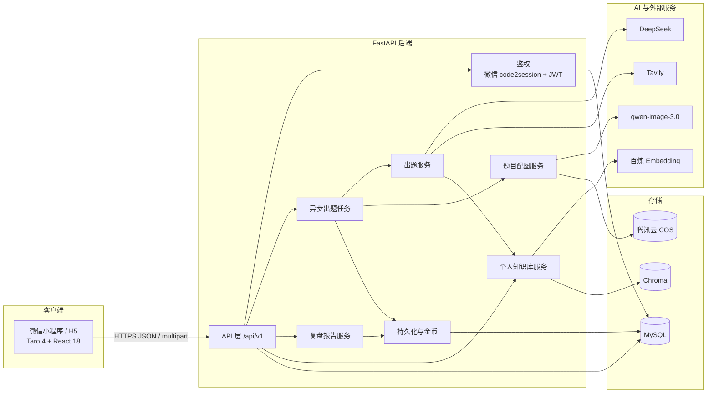
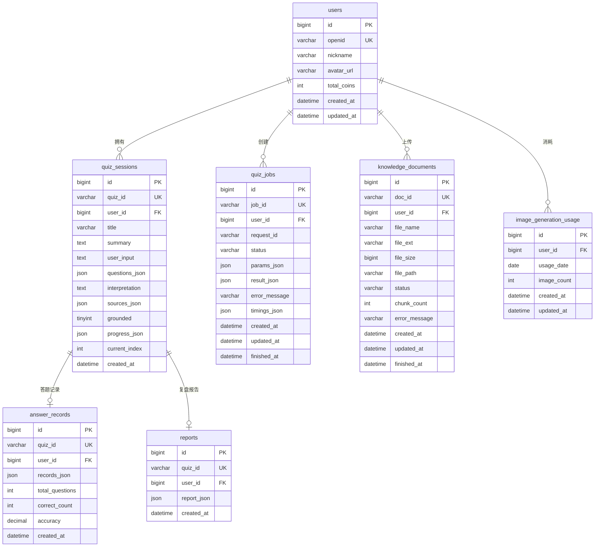

# AI Learn · AI 闯关学习小程序

**中文** | [English](README_EN.md)

> 把任意想学的内容，变成一组可闯关、可讲解、可复盘的 AI 题目。

AI Learn 是一个「输入 → AI 出题 → 答题闯关 → 复盘报告」的完整学习闭环项目：

- **前端**：Taro 4 + React 18 + TypeScript 的微信小程序（同时保留 H5 构建能力）
- **后端**：FastAPI + MySQL + LangChain 的 AI 服务
- **AI 能力**：DeepSeek 出题与报告、Tavily 联网接地、百炼 Embedding + Chroma 个人知识库、qwen-image-3.0 题目配图
- **基础设施**：微信登录、JWT 鉴权、腾讯云 COS 对象存储

项目从 MVP 起步，已经逐步补齐用户系统、异步出题、联网检索、个人知识库、题目配图、头像与配额、时区口径等能力，并用 OpenSpec 对每次变更做了规格归档。

---

## 目录

- [1. 功能概览](#1-功能概览)
- [2. 技术栈](#2-技术栈)
- [3. 系统架构](#3-系统架构)
- [4. 核心链路](#4-核心链路)
- [5. 页面与交互](#5-页面与交互)
- [6. 目录结构](#6-目录结构)
- [7. 快速开始](#7-快速开始)
- [8. 配置说明](#8-配置说明)
- [9. API 一览](#9-api-一览)
- [10. 数据模型](#10-数据模型)
- [11. 测试](#11-测试)
- [12. 开发流程](#12-开发流程)
- [13. 部署与生产检查](#13-部署与生产检查)
- [14. 常见问题](#14-常见问题)
- [15. 文档与原型](#15-文档与原型)
- [16. 路线图](#16-路线图)
- [17. 许可证](#17-许可证)

---

## 1. 功能概览

| 能力 | 说明 |
| --- | --- |
| 多源出题 | 支持一句主题、一段文本、网页链接；个人知识库模式支持上传 PDF / Word(.docx) / Markdown / 纯文本 |
| 三种出题路径 | 通用出题（无外部资料）、联网接地出题（Tavily 检索/抽取）、个人知识库出题（仅检索所选文档） |
| 结构化题库 | 单选、多选、判断三种题型；每题包含选项、标准答案、详细讲解、知识点、难度，可选配图 |
| 异步出题任务 | 创建任务后轮询状态，避免长请求超时；支持幂等 `request_id`、并发上限、超时兜底、服务重启清理 |
| 闯关答题 | 提交即判题、即时讲解；支持上一题/下一题、进度条、答对金币即时反馈 |
| 断点续答 | 逐题上报进度；从历史记录进入未完成闯关时恢复题号与已答记录 |
| 复盘报告 | 服务端重算正确率与掌握/薄弱知识点，LLM 生成三句总结、复习建议与分享金句 |
| 闯关历史 | 分页列表、报告回看、未完成闯关继续作答 |
| 用户系统 | 微信静默登录、JWT 鉴权、昵称修改、头像上传、个人统计 |
| 个人知识库 | 文档上传、异步解析分块、百炼 Embedding、Chroma 向量检索、相关度阈值过滤、文档删除 |
| 题目配图 | 百炼 qwen-image-3.0 生图、腾讯云 COS 公有读存储、每日配额预留与失败退还 |
| 接地可追溯 | 出题结果携带参考来源；来源从工具返回的 artifact 确定性抽取，不信任模型编造的 URL |
| 北京时间口径 | 新写入的数据库时间与「当日」配额统一按北京时间计算，历史数据不回填 |

> 前端默认固定生成 **5 道题**；后端接口本身支持 3～10 道，便于后续扩展。

---

## 2. 技术栈

### 前端

| 类别 | 选型 |
| --- | --- |
| 跨端框架 | Taro 4.3 |
| 视图库 | React 18 |
| 语言 | TypeScript |
| 样式 | Sass |
| 构建 | Webpack 5 |
| 目标端 | 微信小程序（主）、H5（预览/调试） |
| 状态与缓存 | Taro Storage（当前闯关会话、token、用户缓存、进行中任务） |
| 工程规范 | ESLint、Stylelint、Husky、commitlint |

### 后端

| 类别 | 选型 |
| --- | --- |
| Web 框架 | FastAPI |
| 运行环境 | Python 3.11+ |
| 数据校验 | Pydantic v2 |
| 数据库 | MySQL 8.x + aiomysql 连接池 |
| 鉴权 | 微信 `jscode2session` + JWT（PyJWT / HS256） |
| LLM 编排 | LangChain 1.x + langchain-openai |
| 大模型 | DeepSeek（OpenAI 兼容接口，`deepseek-flash`，显式关闭 thinking） |
| 联网检索 | Tavily（langchain-tavily） |
| 知识库 | 百炼 `text-embedding-v4` + Chroma（本地持久化） |
| 文档解析 | PyPDF、docx2txt、LangChain TextLoader / RecursiveCharacterTextSplitter |
| 生图 | 百炼 qwen-image-3.0 |
| 对象存储 | 腾讯云 COS（题目配图、用户头像） |
| 日志 | structlog + 轮转文件日志 |
| 测试 | pytest + pytest-asyncio |

---

## 3. 系统架构



### 后端分层

| 层 | 目录 | 职责 |
| --- | --- | --- |
| API 层 | `backend/app/api/v1/routes/` | 参数校验、鉴权依赖、统一响应 |
| 核心层 | `backend/app/core/` | 配置、MySQL 连接池、JWT、异常、日志 |
| 模型层 | `backend/app/models/` | Pydantic 请求/响应模型与统一错误码 |
| 仓储层 | `backend/app/repositories/` | 封装 SQL，避免 SQL 散落到业务层 |
| 服务层 | `backend/app/services/` | 出题任务、出题、报告、知识库、配图、用户、历史、持久化 |
| LLM 层 | `backend/app/llm/` | 模型工厂、出题/报告链、研究 Agent、Tavily 工具、向量库、文档解析 |
| Prompt 层 | `backend/app/prompts/` | 版本化 Prompt 与 JSON 结构示例 |
| 工具层 | `backend/app/utils/` | 文本清洗、敏感词、ID、北京时间 |

---

## 4. 核心链路

### 4.1 出题主流程

```text
用户输入
  → 文本清洗（折叠空白、截断 4000 字）
  → 敏感词校验
  → 按开关选择路径
      ├─ 知识库：仅检索所选文档（不联网）
      ├─ 联网：研究 Agent 检索/抽取 → 研究简报 → 结构化出题
      └─ 通用：清洗后的输入直接结构化出题
  → 题目合法性校验（字段、选项、答案、题型）
  → 可选配图（知识库任务强制跳过）
  → 落库 quiz_sessions
  → 任务标记 completed，前端轮询取回题库
```

#### 三条路径的差异

| 路径 | 触发条件 | 阶段一 | 阶段二 | 失败降级 |
| --- | --- | --- | --- | --- |
| 通用出题 | 未开联网、未开知识库，或联网能力不可用 | 无 | `json_mode` 结构链 | 重试后仍失败则报错 |
| 联网接地 | `use_web_search=true` 且配置了 Tavily Key | 研究 Agent 自主选择 `web_search_brief` / `web_search_full` / `web_extract` | 研究简报 + 用户输入 → `json_mode` 结构链 | 接地失败自动降级为通用出题 |
| 知识库接地 | `use_knowledge_base=true` + `document_id` | 研究 Agent 仅调用 `search_knowledge_base`，范围锁定单文档 | 研究简报 → `json_mode` 结构链 | 无有效文档来源或接地失败时降级为通用出题 |

#### 为什么是两阶段

DeepSeek 对「工具调用式结构化输出」支持不够稳定，因此项目把出题拆成两段：

1. **研究阶段**：Agent 只负责检索/抽取，输出一段中文研究简报；
2. **结构化阶段**：把简报作为上下文，用已验证稳定的 `json_mode` 链输出严格 JSON。

这样既保留了 Agent 自主检索的灵活性，又保证了题库结构的稳定性。

#### 来源可信

- 联网来源从 Tavily 工具的 `artifact` 中提取，知识库来源从检索结果中提取；
- 每个来源包含 `kind`（`search` / `extract` / `knowledge_base`）、标题、URL、相关度、文档名、页码、片段摘要等；
- 模型只负责写题与讲解，**不负责编造来源 URL**；
- 知识库来源低于 `KB_MIN_RELEVANCE_SCORE`（默认 0.60）会被过滤。

#### 题目校验

服务层会对模型输出做二次校验，不只依赖模型自觉：

- 字段完整性、选项不少于 2 个；
- 选项 key 不重复；
- 答案必须属于选项集合；
- 单选/判断答案恰好 1 个，多选答案不少于 2 个；
- 校验失败按 `LLM_MAX_RETRIES + 1` 次重试，仍失败则返回统一错误。

### 4.2 异步出题任务

前端调用 `POST /api/v1/quiz/jobs` 创建任务，后端立即返回 `job_id`，后台执行：

```text
pending → running → completed
                  ↘ failed
```

关键设计：

- `request_id` + 数据库唯一键 `(user_id, request_id)` 保证重复提交幂等；
- 进程内 `asyncio` 任务 + 信号量限制并发（默认 2）；
- `QUIZ_JOB_TIMEOUT_SECONDS`（默认 300 秒）兜底超时；
- 服务启动时把残留的 `pending/running` 任务标记为失败，避免永久卡住；
- 前端把进行中任务写入本地缓存，退出再回来可继续轮询；
- `timings_json` 记录 `queue_ms`、`research_ms`、`phase2_ms`、`images_ms`、`persist_ms`、`total_ms` 及工具调用次数，便于定位慢点。

> 当前实现是**单实例、进程内任务**。多实例部署时应替换为外部任务队列（如 Celery / RQ / Redis 队列）。

### 4.3 答题与报告

1. 前端逐题本地判题，提交后立即展示正确答案与讲解；
2. 每次切题/作答通过 `POST /api/v1/quiz/progress` 上报进度；
3. 全部完成后调用 `POST /api/v1/report/generate`；
4. 后端用本地统计重新计算正确率、掌握点、薄弱点；
5. LLM 只生成文字性内容：三句总结、复习建议、分享金句；
6. 报告与答题记录落库，并按答对数累加金币。

**金币规则**：每答对一题 +10 金币。前端答题时即时显示，服务端在报告落库时统一入账；`answer_records.quiz_id` 唯一，重复生成报告不会重复加币。

**判定规则**：服务端按「所选集合 == 标准答案集合」重算对错；找不到对应题目时，才退回信任前端提交的 `is_correct`。同一知识点既答对又答错时，以「薄弱」为准。

### 4.4 个人知识库

```text
上传文件
  → 校验扩展名/大小/文件名
  → 落盘 backend/data/knowledge_base/{user_id}/{doc_id}/
  → 创建 knowledge_documents 记录（pending）
  → 后台异步解析、分块、Embedding、写入 Chroma
  → processing → ready / failed
```

- 支持格式：PDF、Word（.docx）、Markdown、纯文本；
- 单文件上限默认 10MB，单文档最多 2000 个分块；
- 每个用户一个 Chroma collection：`kb_user_{user_id}`；
- 分块 ID 为 `{doc_id}:{chunk_index}`，使用 `upsert` 保证重试幂等；
- 向量空间使用余弦距离，相关度按 `1 - distance` 计算；
- Embedding 维度建库后不可变，修改 `EMBEDDING_DIMENSIONS` 需清空向量目录重建；
- 删除文档时同时清理向量与本地文件；
- 服务重启时把残留 `pending/processing` 文档标记为失败。

前端首页只展示 `ready` 状态的文档，且**单选一份**文档出题；知识库出题不联网。

### 4.5 题目配图

- 仅当 `ENABLE_IMAGE_GENERATION=true`、配置了百炼 Key 与 COS 时才可用；
- 知识库任务强制不配图；
- 默认每日每用户 100 张，按北京时间自然日计算；
- 先预留配额，失败题目退还配额；
- 同步调用 qwen-image-3.0，429/5xx 有界重试并加抖动；
- 生成结果上传到 COS 公有读桶，URL 写入 `question.image_url`；
- 单题配图失败不影响题库生成，只是该题没有图。

### 4.6 登录与鉴权

```text
小程序启动
  → Taro.login() 获取 code
  → POST /api/v1/user/login
  → 后端 jscode2session 换 openid
  → 不存在则自动注册
  → 签发 JWT（默认 30 天）
  → 前端保存 token，后续请求带 Authorization: Bearer <token>
```

- AppSecret 只存在后端，绝不下发前端；
- 请求返回业务码 `4010` 时，前端自动清空登录态并静默重登一次；
- 登录失败不阻塞浏览，但依赖用户身份的功能（创建出题任务、历史、知识库等）需要登录。

---

## 5. 页面与交互

| 页面 | 路径 | 主要能力 |
| --- | --- | --- |
| 首页 | `pages/index/index` | 输入学习内容；联网检索、配图、知识库三个开关；创建异步任务并轮询；历史记录分页 |
| 闯关页 | `pages/quiz/index` | 单选/多选/判断；即时判题；讲解折叠；配图展示；来源展示；断点续答 |
| 报告页 | `pages/report/index` | 正确率、掌握点、薄弱点、三句总结、建议、金句；历史报告回看 |
| 题库页 | `pages/bank/index` | 上传文档、查看处理状态、轮询刷新、删除文档 |
| 我的 | `pages/profile/index` | 头像上传、昵称修改、金币、闯关次数、答对题数、平均正确率、历史记录 |

底部导航：**闯关 / 题库 / 我的**。

首页三个开关的交互约束：

- 「联网检索」与「知识库」互斥，开启一个会关闭另一个；
- 选择知识库文档后自动关闭联网与配图；
- 配图额度用尽或配图能力不可用时，配图开关禁用；
- 选择知识库文档时，若输入框为空，会自动填入一句围绕该文档的出题提示。

---

## 6. 目录结构

```text
ai-learn/
├─ backend/
│  ├─ app/
│  │  ├─ api/v1/routes/          # health / quiz / report / user / knowledge_base
│  │  ├─ core/                   # config / db / auth / exceptions / logging
│  │  ├─ models/                 # Pydantic 模型与统一响应
│  │  ├─ repositories/           # MySQL CRUD
│  │  ├─ services/               # 业务服务
│  │  ├─ llm/                    # 模型工厂、链、Agent、Tavily、Chroma、文档解析
│  │  ├─ prompts/                # 出题与报告 Prompt
│  │  ├─ utils/                  # 文本清洗、敏感词、ID、北京时间
│  │  └─ main.py                 # FastAPI 入口与 lifespan
│  ├─ tests/                     # pytest 测试
│  ├─ data/                      # 运行期数据（Chroma、上传文件，gitignore）
│  ├─ logs/                      # 运行期日志（gitignore）
│  ├─ requirements.txt
│  ├─ pytest.ini
│  └─ .env.example
├─ frontend/
│  ├─ src/
│  │  ├─ pages/                  # index / quiz / report / bank / profile
│  │  ├─ components/             # CoinPill / ProgressRing / TabBar / UserAvatar
│  │  ├─ services/               # request / auth / api / config
│  │  ├─ store/                  # 当前会话与本地缓存
│  │  ├─ utils/                  # 正确率颜色、来源展示
│  │  ├─ types/                  # 前端类型定义
│  │  ├─ app.config.ts           # 页面与窗口配置
│  │  └─ app.ts                  # 启动静默登录
│  ├─ config/                    # Taro 构建配置
│  ├─ package.json
│  └─ project.config.json        # 微信开发者工具项目配置
├─ sql/
│  ├─ init_mysql.sql             # 当前完整建库建表脚本（幂等）
│  └─ migrations/                # 历史增量迁移脚本
├─ docs/                         # 方案、需求、OpenSpec 教程
├─ openspec/
│  ├─ specs/                     # 当前生效规格
│  └─ changes/archive/           # 已归档变更（proposal / design / tasks / delta specs）
├─ prototypes/                   # 高保真 HTML 原型
├─ start-backend.bat             # Windows 一键启动后端
├─ start-frontend.bat            # Windows 一键启动前端 watch
├─ start-dev.bat                 # Windows 同时启动前后端
├─ README.md
└─ README_EN.md
```

关键入口：

- 后端入口：[`backend/app/main.py`](backend/app/main.py)
- 后端配置：[`backend/app/core/config.py`](backend/app/core/config.py)
- 出题主流程：[`backend/app/services/quiz_service.py`](backend/app/services/quiz_service.py)
- 异步任务：[`backend/app/services/quiz_job_service.py`](backend/app/services/quiz_job_service.py)
- 研究 Agent：[`backend/app/llm/quiz_agent.py`](backend/app/llm/quiz_agent.py)
- 知识库向量层：[`backend/app/llm/knowledge_base.py`](backend/app/llm/knowledge_base.py)
- 前端请求封装：[`frontend/src/services/request.ts`](frontend/src/services/request.ts)
- 首页：[`frontend/src/pages/index/index.tsx`](frontend/src/pages/index/index.tsx)

---

## 7. 快速开始

### 7.1 环境要求

| 依赖 | 版本/说明 |
| --- | --- |
| Python | 3.11+ |
| Node.js | 18+，建议 20 LTS |
| MySQL | 8.x |
| 微信开发者工具 | 运行小程序必需 |
| 可选账号 | DeepSeek、Tavily、阿里云百炼、腾讯云 COS |

> 没有外部 API Key 也可以启动项目：基础页面、数据库、历史记录可用；AI 出题、联网、知识库、配图会按能力开关降级或不可用。

### 7.2 获取代码

```bash
git clone <your-repository-url>
cd ai-learn
```

### 7.3 启动 MySQL

确保 MySQL 已运行，并准备一个有建库/建表权限的账号。

两种初始化方式任选其一：

**方式 A：让应用自动初始化（默认）**

保持 `MYSQL_AUTO_INIT=true`，首次启动时会执行 `sql/init_mysql.sql`，自动创建 `ai_learn` 数据库与全部表。

**方式 B：手动执行 SQL**

```bash
mysql -u root -p < sql/init_mysql.sql
```

然后设置 `MYSQL_AUTO_INIT=false`。

> `sql/migrations/` 是历史增量脚本，仅用于追溯；新环境直接使用 `sql/init_mysql.sql`。

### 7.4 启动后端

```bash
cd backend

# 创建虚拟环境
python -m venv .venv

# Windows
.venv\Scripts\activate
# macOS / Linux
# source .venv/bin/activate

pip install -r requirements.txt

# 复制配置模板并填写真实值
# Windows
copy .env.example .env
# macOS / Linux
# cp .env.example .env

# 启动
python -m uvicorn app.main:app --host 127.0.0.1 --port 8000 --reload
```

启动成功后：

- 健康检查：<http://127.0.0.1:8000/api/v1/health>
- Swagger 文档：<http://127.0.0.1:8000/docs>
- 日志文件：`backend/logs/backend.log`

### 7.5 启动前端

```bash
cd frontend
npm install
npm run dev:weapp
```

然后打开微信开发者工具：

1. 导入目录：`ai-learn/frontend`
2. 工具会读取 `project.config.json`，小程序产物目录为 `dist/`
3. 在「详情 → 本地设置」勾选 **不校验合法域名、web-view（业务域名）、TLS 版本以及 HTTPS 证书**
4. 编译后即可在模拟器中运行

前端默认请求 `http://127.0.0.1:8000`（见 `frontend/src/services/config.ts`）：

- **微信开发者工具模拟器**：`127.0.0.1` 指向开发机，可直接访问本地后端；
- **真机预览**：把地址改为开发机局域网 IP（如 `http://192.168.1.10:8000`），并确保手机与电脑同一网络；
- 正式环境需要 HTTPS 域名，并在微信公众平台配置合法域名。

### 7.6 H5 预览（可选）

```bash
cd frontend
npm run dev:h5
```

H5 适合快速查看页面布局与交互，但微信登录、`chooseMessageFile`、`chooseAvatar` 等能力依赖微信运行环境，H5 下无法完整跑通全部业务流程。

### 7.7 Windows 一键脚本

已完成依赖安装后，可以直接使用：

```bat
start-dev.bat        :: 同时启动后端与前端
start-backend.bat    :: 只启动后端
start-frontend.bat   :: 只启动前端 watch
```

脚本前置条件：

- `backend\.venv\Scripts\python.exe` 存在；
- `frontend\node_modules` 存在。

---

## 8. 配置说明

后端配置来自 `backend/.env`（由 `pydantic-settings` 读取），模板见 [`backend/.env.example`](backend/.env.example)。所有配置项均为可选，未填写时使用代码默认值；但 AI 相关能力需要对应 Key 才会启用。

### 8.1 基础与 LLM

| 变量 | 默认值 | 说明 |
| --- | --- | --- |
| `APP_ENV` | `development` | 运行环境；`test` 时不写文件日志 |
| `LOG_LEVEL` | `INFO` | 日志级别 |
| `DEEPSEEK_API_KEY` | 空 | DeepSeek API Key，出题/报告必需 |
| `DEEPSEEK_BASE_URL` | `https://api.deepseek.com` | OpenAI 兼容接口地址 |
| `DEEPSEEK_MODEL` | `deepseek-flash` | 模型名 |
| `LLM_TIMEOUT` | `30` | LLM 请求超时（秒） |
| `LLM_MAX_RETRIES` | `2` | LLM 重试次数（总尝试次数 = 重试 + 1） |
| `QUIZ_TEMPERATURE` | `0.4` | 出题温度 |
| `QUIZ_MAX_TOKENS` | `4096` | 出题最大 token |
| `REPORT_TEMPERATURE` | `0.5` | 报告温度 |
| `REPORT_MAX_TOKENS` | `2048` | 报告最大 token |

### 8.2 微信登录与 JWT

| 变量 | 默认值 | 说明 |
| --- | --- | --- |
| `WECHAT_APPID` | 空 | 小程序 AppID |
| `WECHAT_APPSECRET` | 空 | 小程序 AppSecret，仅后端持有 |
| `JWT_SECRET` | 不安全的开发默认值 | **生产必须替换**为随机长字符串 |
| `JWT_EXPIRE_DAYS` | `30` | token 有效期（天） |

生成随机 JWT Secret：

```bash
python -c "import secrets; print(secrets.token_hex(32))"
```

### 8.3 MySQL

| 变量 | 默认值 | 说明 |
| --- | --- | --- |
| `MYSQL_HOST` | `localhost` | 主机 |
| `MYSQL_PORT` | `3306` | 端口 |
| `MYSQL_USER` | `root` | 用户名 |
| `MYSQL_PASSWORD` | 空 | 密码 |
| `MYSQL_DATABASE` | `ai_learn` | 数据库名 |
| `MYSQL_CHARSET` | `utf8mb4` | 字符集 |
| `MYSQL_POOL_MINSIZE` | `1` | 连接池最小连接数 |
| `MYSQL_POOL_MAXSIZE` | `10` | 连接池最大连接数 |
| `MYSQL_AUTO_INIT` | `true` | 启动时执行 `sql/init_mysql.sql` |
| `MYSQL_TIME_ZONE` | `+08:00` | 连接会话时区（北京时间） |

### 8.4 联网检索（Tavily）

| 变量 | 默认值 | 说明 |
| --- | --- | --- |
| `TAVILY_API_KEY` | 空 | 未配置时联网能力不可用，出题自动走通用路径 |
| `ENABLE_WEB_SEARCH` | `true` | 联网总开关 |
| `TAVILY_SEARCH_BRIEF_MAX_RESULTS` | `5` | 摘要检索返回条数 |
| `TAVILY_SEARCH_FULL_MAX_RESULTS` | `3` | 全文检索返回条数 |
| `TAVILY_SEARCH_FULL_DEPTH` | `advanced` | 全文检索深度 |
| `TAVILY_EXTRACT_DEPTH` | `advanced` | 网页抽取深度 |
| `TAVILY_EXTRACT_FORMAT` | `markdown` | 网页抽取格式 |
| `TAVILY_COUNTRY` | 空 | 地区加权，空表示全球 |
| `QUIZ_AGENT_TOOL_CALL_LIMIT` | `10` | 研究 Agent 单次最多工具调用次数 |
| `QUIZ_AGENT_RECURSION_LIMIT` | `30` | Agent 图执行步数上限 |
| `QUIZ_DIGEST_MAX_CHARS` | `2000` | 单条检索/抽取正文注入模型前的截断长度 |

### 8.5 异步任务

| 变量 | 默认值 | 说明 |
| --- | --- | --- |
| `QUIZ_JOB_TIMEOUT_SECONDS` | `300` | 任务超时兜底（秒） |
| `QUIZ_JOB_MAX_CONCURRENCY` | `2` | 单实例并发出题数 |

### 8.6 个人知识库

| 变量 | 默认值 | 说明 |
| --- | --- | --- |
| `ENABLE_KNOWLEDGE_BASE` | `true` | 知识库总开关 |
| `DASHSCOPE_API_KEY` | 空 | 百炼 Key，知识库与生图共用 |
| `EMBEDDING_BASE_URL` | `https://dashscope.aliyuncs.com/compatible-mode/v1` | Embedding 接口 |
| `EMBEDDING_MODEL` | `text-embedding-v4` | Embedding 模型 |
| `EMBEDDING_DIMENSIONS` | `1024` | 向量维度，建库后不可变 |
| `EMBEDDING_BATCH_SIZE` | `8` | 批量 Embedding 大小 |
| `EMBEDDING_TIMEOUT` | `30` | Embedding 超时（秒） |
| `EMBEDDING_MAX_RETRIES` | `2` | Embedding 重试次数 |
| `CHROMA_PERSIST_DIR` | `data/chroma` | Chroma 持久化目录（相对 `backend/`） |
| `KB_UPLOAD_DIR` | `data/knowledge_base` | 上传文件目录（相对 `backend/`） |
| `KB_MAX_FILE_MB` | `10` | 单文件大小上限 |
| `KB_CHUNK_SIZE` | `800` | 分块大小 |
| `KB_CHUNK_OVERLAP` | `100` | 分块重叠 |
| `KB_MAX_CHUNKS_PER_DOC` | `2000` | 单文档最大分块数 |
| `KB_RETRIEVAL_TOP_K` | `4` | 检索返回分块数 |
| `KB_MIN_RELEVANCE_SCORE` | `0.60` | 知识库最低相关度阈值 |
| `KB_INGESTION_CONCURRENCY` | `2` | 建库并发数 |

### 8.7 题目配图与 COS

| 变量 | 默认值 | 说明 |
| --- | --- | --- |
| `ENABLE_IMAGE_GENERATION` | `true` | 配图总开关 |
| `IMAGE_BASE_URL` | `https://dashscope.aliyuncs.com/api/v1` | 百炼生图接口 |
| `IMAGE_MODEL` | `qwen-image-3.0` | 生图模型 |
| `IMAGE_SIZE` | `512*512` | 图片尺寸 |
| `IMAGE_TIMEOUT_SECONDS` | `45` | 生图超时（秒） |
| `IMAGE_MAX_CONCURRENCY` | `6` | 生图并发数 |
| `IMAGE_DAILY_LIMIT` | `100` | 每用户每日配图额度 |
| `IMAGE_MAX_RETRIES` | `3` | 生图重试次数 |
| `IMAGE_RETRY_BACKOFF_SECONDS` | `2.0` | 重试退避基数 |
| `COS_SECRET_ID` | 空 | 腾讯云 SecretId |
| `COS_SECRET_KEY` | 空 | 腾讯云 SecretKey |
| `COS_REGION` | 空 | COS 地域 |
| `COS_BUCKET` | 空 | COS 存储桶（需公有读） |
| `COS_PUBLIC_BASE_URL` | 空 | 自定义 CDN/域名，空则用默认 COS 域名 |
| `COS_KEY_PREFIX` | `question-images` | 题目配图对象前缀 |
| `COS_AVATAR_PREFIX` | `avatars` | 头像对象前缀 |
| `AVATAR_MAX_FILE_MB` | `2` | 头像大小上限 |

> 使用 COS 时请创建**公有读**存储桶，并把图片域名加入微信小程序「downloadFile 合法域名」。头像上传会按文件魔数校验 PNG / JPEG / WebP，不信任文件名与 Content-Type。

---

## 9. API 一览

### 9.1 约定

- 基础路径：`/api/v1`
- 鉴权：`Authorization: Bearer <JWT>`
- 统一响应结构：

```json
{
  "code": 0,
  "message": "ok",
  "data": {}
}
```

- **业务错误也返回 HTTP 200**，通过 `code` 区分；`code=0` 表示成功。
- 上传接口使用 `multipart/form-data`，字段名统一为 `file`。

### 9.2 接口列表

| 方法 | 路径 | 鉴权 | 说明 |
| --- | --- | --- | --- |
| `GET` | `/health` | 无 | 健康检查 |
| `POST` | `/user/login` | 无 | 微信 code 换 token |
| `GET` | `/user/profile` | 必须 | 个人档案、统计、配图额度、能力开关 |
| `PUT` | `/user/profile` | 必须 | 修改昵称/头像 URL |
| `POST` | `/user/avatar` | 必须 | 上传头像（multipart） |
| `GET` | `/user/quizzes` | 必须 | 闯关历史分页 |
| `GET` | `/user/quizzes/{quiz_id}` | 必须 | 闯关详情（题目、答题记录、报告、进度、来源） |
| `POST` | `/quiz/jobs` | 必须 | 创建异步出题任务 |
| `GET` | `/quiz/jobs/{job_id}` | 必须 | 查询任务状态与结果 |
| `POST` | `/quiz/progress` | 必须 | 上报断点续答进度 |
| `POST` | `/report/generate` | 可选 | 生成复盘报告；带 token 时落库并加金币 |
| `GET` | `/knowledge-base` | 必须 | 知识库概览与全部文档 |
| `GET` | `/knowledge-base/documents` | 必须 | 文档分页列表 |
| `POST` | `/knowledge-base/documents` | 必须 | 上传文档（multipart，可选 `file_name`） |
| `DELETE` | `/knowledge-base/documents/{doc_id}` | 必须 | 删除文档及其向量 |

### 9.3 创建出题任务

```http
POST /api/v1/quiz/jobs
Authorization: Bearer <JWT>
Content-Type: application/json
```

```json
{
  "user_input": "我想学习什么是 RAG",
  "question_count": 5,
  "difficulty": "mixed",
  "use_web_search": false,
  "use_knowledge_base": false,
  "document_id": null,
  "generate_images": false,
  "request_id": "1729500000000_ab12cd34"
}
```

字段约束：

| 字段 | 类型 | 必填 | 说明 |
| --- | --- | --- | --- |
| `user_input` | string | 是 | 1～4000 字 |
| `question_count` | int | 否 | 3～10，默认 5 |
| `difficulty` | string | 否 | `easy` / `medium` / `hard` / `mixed`，默认 `mixed` |
| `use_web_search` | bool | 否 | 是否联网检索 |
| `use_knowledge_base` | bool | 否 | 是否使用个人知识库 |
| `document_id` | string | 条件 | 知识库模式必填；非知识库模式禁止携带 |
| `generate_images` | bool | 否 | 是否配图；知识库模式强制关闭 |
| `request_id` | string | 是 | 客户端幂等 ID，同一用户内唯一 |

约束：`use_web_search` 与 `use_knowledge_base` **不能同时为 true**；请求体禁止未知字段。

响应：

```json
{
  "code": 0,
  "message": "ok",
  "data": {
    "job_id": "job_7f3a9c2d1e4b5a6c",
    "status": "pending"
  }
}
```

轮询：

```http
GET /api/v1/quiz/jobs/job_7f3a9c2d1e4b5a6c
```

```json
{
  "code": 0,
  "message": "ok",
  "data": {
    "job_id": "job_7f3a9c2d1e4b5a6c",
    "status": "completed",
    "quiz": {
      "quiz_id": "quiz_1234567890abcdef",
      "title": "RAG 入门",
      "summary": "围绕 RAG 基础概念生成的题库",
      "interpretation": "按检索增强生成的技术语境出题",
      "source_type": "text",
      "user_input": "我想学习什么是 RAG",
      "questions": [],
      "sources": [],
      "grounded": false
    },
    "error": null
  }
}
```

### 9.4 生成报告

```json
{
  "quiz_id": "quiz_1234567890abcdef",
  "topic": "RAG 入门",
  "questions": [],
  "answer_records": [
    {
      "question_id": "q1",
      "selected_answers": ["A"],
      "is_correct": true,
      "duration_ms": 3200
    }
  ]
}
```

响应：

```json
{
  "code": 0,
  "message": "ok",
  "data": {
    "accuracy": 80,
    "mastered_points": ["RAG 的基本定义"],
    "weak_points": ["RAG 与搜索引擎的边界"],
    "three_line_summary": ["...", "...", "..."],
    "advice": ["...", "..."],
    "share_quote": "把知识做成关卡，记忆会更深。"
  }
}
```

### 9.5 业务错误码

| code | 含义 |
| --- | --- |
| `0` | 成功 |
| `4000` | 请求参数校验失败 |
| `4001` | 题库生成失败 |
| `4002` | 报告生成失败 |
| `4003` | 内容触发敏感词过滤 |
| `4004` | 微信登录失败 |
| `4005` | 知识库操作失败 |
| `4006` | 文档处理失败 |
| `4007` | 知识库服务未配置或不可用 |
| `4010` | 未登录或登录已过期 |
| `4040` | 记录不存在 |
| `5000` | 未处理的服务器错误 |
| `5001` | 服务暂时不可用 |

---

## 10. 数据模型



关键约束：

- `users.openid` 唯一；
- `quiz_sessions.quiz_id` 唯一；
- `answer_records.quiz_id`、`reports.quiz_id` 唯一，保证报告重复提交只覆盖不重复加币；
- `quiz_jobs.job_id` 唯一，`(user_id, request_id)` 唯一，保证创建任务幂等；
- `knowledge_documents.doc_id` 唯一；
- `image_generation_usage.(user_id, usage_date)` 唯一，保证每日配额按自然日累计；
- 所有字段均带中文 `COMMENT`，表级也有注释，便于直接阅读库结构。

> 时区约定：连接会话默认 `+08:00`，新写入时间按北京时间；历史数据保持原值，不做批量回填。

---

## 11. 测试

后端测试位于 `backend/tests/`，当前包含 **46 个测试模块、370+ 个测试用例**，覆盖：

- 鉴权、用户接口、历史接口
- 出题服务与三条出题路径
- 异步任务创建、状态流转、超时、断点
- 报告生成与评分逻辑
- 知识库上传、解析、分块、Embedding、向量检索、阈值过滤
- 配图模型、配额预留/退还、配置校验
- Prompt 契约、文本清洗、敏感词、时区工具
- 头像格式识别、数据库初始化等

运行：

```bash
cd backend
.venv\Scripts\python -m pytest
# macOS / Linux
# .venv/bin/python -m pytest
```

特点：

- `pytest.ini` 已配置 `asyncio_mode = auto`；
- `tests/conftest.py` 注入测试用 DeepSeek Key，**不会调用真实外部 API**；
- 数据库测试使用 `tests/fake_db.py` 替换 `app.core.db`，无需本地 MySQL；
- 外部模型、检索、生图、存储均可通过参数注入替身。

前端目前以微信开发者工具 / H5 手动验证为主，可通过 `npm run build:weapp` 做构建校验。

---

## 12. 开发流程

### 12.1 OpenSpec 规格驱动

项目使用 OpenSpec 管理需求变更：

- `openspec/specs/`：当前生效的规格（知识库、题目配图、出题、异步任务、用户档案、时区等）；
- `openspec/changes/archive/`：已归档的变更，包含 proposal、design、tasks 与 delta specs；
- `.qoder/commands/opsx/` 与 `.qoder/skills/`：辅助 propose / apply / archive / sync 的流程定义。

推荐流程：

```text
探索问题 → propose（提案 + 设计 + 规格 + 任务）
        → apply（按任务实现并测试）
        → archive（归档变更并同步主规格）
```

这样每次功能演进都能追溯到「为什么做、怎么设计、改了哪些规格」。

### 12.2 后端开发约定

- 先写失败测试，再实现功能，最后跑全量回归；
- 新增接口遵循「路由 → 服务 → 仓储」分层；
- 业务错误统一抛 `AppError` 子类，由全局处理器转为 `{code, message, data}`；
- 落库失败只记日志，不阻断出题/报告主流程；
- 新增 SQL 字段必须带中文 `COMMENT`，表也要有表级注释；
- 涉及第三方能力时保留降级路径，避免单一外部服务故障导致主流程不可用。

### 12.3 相关脚本

```bash
# 后端
cd backend
python -m pytest

# 前端
cd frontend
npm run dev:weapp      # 微信小程序 watch
npm run build:weapp    # 小程序构建
npm run dev:h5         # H5 watch
npm run build:h5       # H5 构建
```

---

## 13. 部署与生产检查

### 13.1 必做项

- [ ] 设置强随机 `JWT_SECRET`，不要使用仓库默认值
- [ ] 配置 HTTPS 反向代理（Nginx / Caddy），微信小程序只接受 HTTPS 域名
- [ ] 在微信公众平台配置 `request` / `uploadFile` / `downloadFile` 合法域名
- [ ] 把 COS 或自定义 CDN 图片域名加入 `downloadFile` 合法域名
- [ ] 生产环境设置 `MYSQL_AUTO_INIT=false`，用受控流程执行 SQL
- [ ] 限制 CORS 来源（当前代码默认 `allow_origins=["*"]`，仅适合开发）
- [ ] 备份 MySQL、`backend/data/chroma` 与 `backend/data/knowledge_base`
- [ ] 确认 `.env` 未提交到 Git
- [ ] 检查日志目录可写，配置日志轮转与磁盘告警

### 13.2 架构限制

当前实现有几个明确的单实例假设：

1. **异步出题任务**运行在 FastAPI 进程内，使用内存信号量控制并发；多实例部署会各自为政，任务状态可能不同步。需要多实例时请替换为外部任务队列。
2. **Chroma 向量库**使用本地持久化目录；多实例需要共享存储或改用独立向量数据库服务。
3. **知识库上传文件**保存在本地磁盘；多实例需要共享文件存储或对象存储。
4. 服务重启会把进行中的任务/文档标记为失败，这是有意的兜底行为。

### 13.3 可观测性

- 结构化日志输出到控制台与 `backend/logs/backend.log`（5MB 轮转，保留 3 份）；
- 出题任务完成/失败时记录 `quiz_job_timing`，包含各阶段耗时与工具调用次数；
- 健康检查：`GET /api/v1/health`；
- 外部服务失败均有 `warning` 日志，便于定位降级原因。

---

## 14. 常见问题

### Q1：没有 DeepSeek / Tavily / 百炼 / COS 能否启动？

可以。服务会正常启动，数据库与页面可用；对应能力会按配置自动降级或禁用：

- 无 DeepSeek Key：出题/报告不可用；
- 无 Tavily Key：联网开关不可用，出题走通用路径；
- 无百炼 Key：知识库与配图不可用；
- 无 COS 配置：题目配图与头像上传不可用。

个人档案接口会返回 `quiz_capabilities` 与 `image_quota.available`，前端据此禁用对应开关。

### Q2：MySQL 没启动会怎样？

应用仍会启动（`init_db` 失败只记日志），但登录、历史、知识库、任务等依赖数据库的功能不可用。请先检查 `backend/logs/backend.log` 中的 `mysql_init_failed`。

### Q3：真机上请求后端失败？

- 把 `frontend/src/services/config.ts` 中的 `API_BASE_URL` 改成开发机局域网 IP；
- 手机与电脑连接同一网络；
- 微信开发者工具中关闭域名校验只对模拟器有效，真机预览需要正确网络与域名配置。

### Q4：联网检索没有生效？

按顺序检查：

1. `ENABLE_WEB_SEARCH=true`；
2. `TAVILY_API_KEY` 已配置；
3. 服务器能访问 Tavily（代理/防火墙）；
4. 前端「联网检索」开关是否打开；
5. 查看日志中的 `web_grounding_unavailable_fallback_plain` 或 `grounded_quiz_fallback`。

联网失败会自动降级为通用出题，不会阻断整个流程。

### Q5：知识库上传后一直处理中或失败？

- 确认 `DASHSCOPE_API_KEY` 已配置，且 `ENABLE_KNOWLEDGE_BASE=true`；
- 检查文档是否为扫描版 PDF（无法提取文本）；
- 检查文件是否超过 10MB 或分块数超过 2000；
- 查看日志中的 `knowledge_ingest_failed`；
- 服务重启会把残留处理中文档标记为失败，需要重新上传。

### Q6：修改了 Embedding 模型或维度怎么办？

维度在 Chroma 建库后不可变。修改 `EMBEDDING_MODEL` 或 `EMBEDDING_DIMENSIONS` 后，需要停止服务、清空 `backend/data/chroma/`，再重新上传文档建库。

### Q7：配图开关是灰的？

可能原因：

- 未配置 `DASHSCOPE_API_KEY` 或 COS；
- `ENABLE_IMAGE_GENERATION=false`；
- 今日额度已用完；
- 已选择知识库文档（知识库任务强制不配图）。

### Q8：为什么报告里的正确率和我自己算的不一样？

报告接口会以服务端重新计算的结果为准：所选答案集合必须与标准答案集合完全一致才算答对。找不到对应题目时，才使用前端提交的 `is_correct`。

### Q9：历史数据时间少 8 小时？

时区改造只保证新写入数据为北京时间，历史数据没有回填。旧记录仍按数据库原值展示，这是预期行为。

### Q10：Windows 下删除 `backend/data/chroma` 失败？

Chroma 使用本地文件锁，删除前先停止后端进程。确认没有残留 Python 进程后再清理目录。

---

## 15. 文档与原型

| 文档 | 说明 |
| --- | --- |
| [方案设计文档](docs/方案设计文档.md) | 技术选型、架构、Prompt、接口、数据模型、分阶段计划 |
| [需求分析文档](docs/需求分析文档.md) | 产品定位、MVP 功能、扩展优先级、用户流程 |
| [用户系统方案设计文档](docs/用户系统方案设计文档.md) | 微信登录、JWT、MySQL 持久化、历史与档案 |
| [用户系统需求分析文档](docs/用户系统需求分析文档.md) | 用户系统需求拆分与验收口径 |
| [OpenSpec 使用教程](docs/OpenSpec使用教程.md) | 本仓库的规格驱动开发流程 |
| [当前规格](openspec/specs/) | knowledge-base / question-images / quiz-generation / quiz-generation-jobs / user-profile / data-timezone |
| [已归档变更](openspec/changes/archive/) | 每次功能演进的设计与任务记录 |
| [高保真原型](prototypes/) | 核心流程、扩展功能、设计系统三份 HTML 原型 |

原型文件：

- `prototypes/01-core-flow.html`
- `prototypes/02-extended-features.html`
- `prototypes/03-design-system-board.html`

---

## 16. 路线图

以下能力来自需求文档，**尚未在当前代码中实现**，仅作为后续方向：

- 分享海报（含小程序码与学习金句）
- 错题本与艾宾浩斯复习提醒
- 社交 PK、排行榜与好友邀请
- 视频/音频等更多输入源解析
- 语音播报、数字人等多模态交互
- VIP、订阅、按量付费等商业化能力
- 多实例部署下的外部任务队列与共享向量存储

已完成的核心能力见[功能概览](#1-功能概览)。

---

## 17. 许可证

仓库当前未包含 `LICENSE` 文件。如需开源分发或商业使用，请先补充许可证并确认第三方服务（DeepSeek、Tavily、阿里云百炼、腾讯云 COS、微信开放平台）的条款与配额要求。

---

**如果这个项目对你有帮助，欢迎 Star。**
