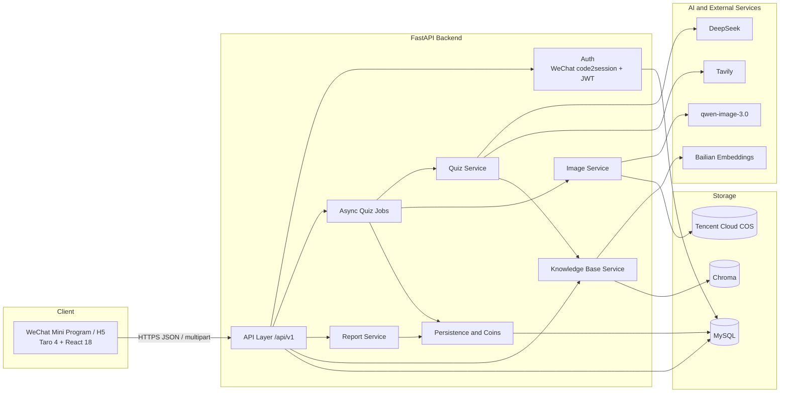
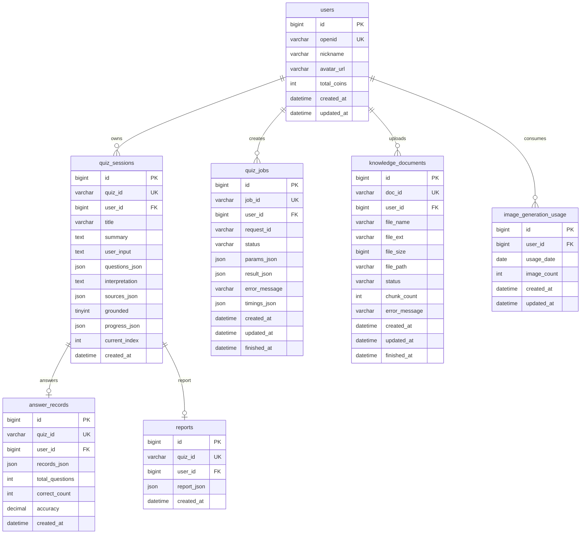

# AI Learn · AI Quiz Quest Mini Program

[中文](README.md) | **English**

> Turn anything you want to learn into a set of AI-generated questions you can play, understand, and review.

AI Learn is a complete learning loop built around **input → AI-generated quiz → quest-style answering → review report**:

- **Frontend**: a WeChat Mini Program built with Taro 4 + React 18 + TypeScript (H5 build is also available)
- **Backend**: an AI service built with FastAPI + MySQL + LangChain
- **AI capabilities**: DeepSeek for quiz/report generation, Tavily for web grounding, Bailian Embeddings + Chroma for a personal knowledge base, and qwen-image-3.0 for question illustrations
- **Infrastructure**: WeChat login, JWT auth, and Tencent Cloud COS object storage

The project started as an MVP and has progressively grown to include a user system, asynchronous quiz generation, web-grounded generation, a personal knowledge base, question images, avatars and quotas, and a Beijing-time convention. Every change is archived with OpenSpec.

---

## Table of Contents

- [1. Feature Overview](#1-feature-overview)
- [2. Tech Stack](#2-tech-stack)
- [3. System Architecture](#3-system-architecture)
- [4. Core Flows](#4-core-flows)
- [5. Pages and Interactions](#5-pages-and-interactions)
- [6. Directory Structure](#6-directory-structure)
- [7. Quick Start](#7-quick-start)
- [8. Configuration](#8-configuration)
- [9. API Reference](#9-api-reference)
- [10. Data Model](#10-data-model)
- [11. Testing](#11-testing)
- [12. Development Workflow](#12-development-workflow)
- [13. Deployment and Production Checklist](#13-deployment-and-production-checklist)
- [14. FAQ](#14-faq)
- [15. Documentation and Prototypes](#15-documentation-and-prototypes)
- [16. Roadmap](#16-roadmap)
- [17. License](#17-license)

---

## 1. Feature Overview

| Capability | Description |
| --- | --- |
| Multiple input sources | A topic, a block of text, or a web link; the personal knowledge base accepts PDF / Word (.docx) / Markdown / plain text |
| Three generation paths | Plain generation (no external material), web-grounded generation (Tavily search/extract), and personal knowledge base generation (retrieves only the selected document) |
| Structured quizzes | Single-choice, multiple-choice, and true/false questions; each includes options, correct answers, explanations, knowledge points, difficulty, and an optional image |
| Asynchronous quiz jobs | Create a job and poll its status to avoid long-request timeouts; supports idempotent `request_id`, concurrency limits, timeout fallback, and startup cleanup |
| Quest-style answering | Instant grading and explanations after submission; previous/next navigation, progress bar, and immediate coin feedback |
| Resume in-progress quizzes | Progress is reported per question; opening an unfinished quiz from history restores the current index and answered records |
| Review report | The server recalculates accuracy and mastered/weak knowledge points; the LLM writes a three-line summary, study advice, and a shareable quote |
| Quiz history | Paginated list, report review, and resume for unfinished quizzes |
| User system | WeChat silent login, JWT auth, nickname editing, avatar upload, and personal statistics |
| Personal knowledge base | Document upload, asynchronous parsing/chunking, Bailian Embeddings, Chroma vector retrieval, relevance threshold filtering, and document deletion |
| Question images | qwen-image-3.0 generation, Tencent Cloud COS public-read storage, daily quota reservation and refund on failure |
| Traceable grounding | Quizzes carry reference sources; sources are deterministically extracted from tool artifacts, not invented by the model |
| Beijing time | Newly written database timestamps and daily quotas use Beijing time; historical data is not backfilled |

> The frontend currently generates **5 questions** per quiz by default. The backend API supports 3–10 questions for future expansion.

---

## 2. Tech Stack

### Frontend

| Category | Choice |
| --- | --- |
| Cross-platform framework | Taro 4.3 |
| View library | React 18 |
| Language | TypeScript |
| Styling | Sass |
| Build | Webpack 5 |
| Targets | WeChat Mini Program (primary), H5 (preview/debugging) |
| State and cache | Taro Storage (current quiz session, token, user cache, active job) |
| Engineering | ESLint, Stylelint, Husky, commitlint |

### Backend

| Category | Choice |
| --- | --- |
| Web framework | FastAPI |
| Runtime | Python 3.11+ |
| Validation | Pydantic v2 |
| Database | MySQL 8.x + aiomysql connection pool |
| Auth | WeChat `jscode2session` + JWT (PyJWT / HS256) |
| LLM orchestration | LangChain 1.x + langchain-openai |
| LLM | DeepSeek (OpenAI-compatible API, `deepseek-flash`, thinking explicitly disabled) |
| Web search | Tavily (langchain-tavily) |
| Knowledge base | Bailian `text-embedding-v4` + Chroma (local persistence) |
| Document parsing | PyPDF, docx2txt, LangChain TextLoader / RecursiveCharacterTextSplitter |
| Image generation | Bailian qwen-image-3.0 |
| Object storage | Tencent Cloud COS (question images and avatars) |
| Logging | structlog + rotating file logs |
| Testing | pytest + pytest-asyncio |

---

## 3. System Architecture



### Backend Layers

| Layer | Directory | Responsibility |
| --- | --- | --- |
| API | `backend/app/api/v1/routes/` | Request validation, auth dependencies, unified responses |
| Core | `backend/app/core/` | Configuration, MySQL pool, JWT, exceptions, logging |
| Models | `backend/app/models/` | Pydantic request/response models and error codes |
| Repositories | `backend/app/repositories/` | SQL encapsulation; keeps SQL out of business logic |
| Services | `backend/app/services/` | Quiz jobs, quiz generation, reports, knowledge base, images, users, history, persistence |
| LLM | `backend/app/llm/` | Model factory, quiz/report chains, research agent, Tavily tools, vector store, document parsing |
| Prompts | `backend/app/prompts/` | Versioned prompts and JSON schema examples |
| Utilities | `backend/app/utils/` | Text cleaning, sensitive words, IDs, Beijing time |

---

## 4. Core Flows

### 4.1 Quiz Generation

```text
User input
  → Text cleaning (collapse whitespace, truncate to 4000 chars)
  → Sensitive-word check
  → Select path based on toggles
      ├─ Knowledge base: retrieve only the selected document (no web)
      ├─ Web: research agent search/extract → research brief → structured generation
      └─ Plain: cleaned input → structured generation
  → Question validation (fields, options, answers, type rules)
  → Optional images (always skipped for knowledge base jobs)
  → Persist to quiz_sessions
  → Mark job completed; the frontend polls and receives the quiz
```

#### Differences Between the Three Paths

| Path | Trigger | Phase 1 | Phase 2 | Fallback |
| --- | --- | --- | --- | --- |
| Plain | Web/KB are off, or web capability is unavailable | None | `json_mode` structured chain | Error after retries |
| Web-grounded | `use_web_search=true` and a Tavily key is configured | Research agent chooses `web_search_brief` / `web_search_full` / `web_extract` | Research brief + user input → `json_mode` chain | Falls back to plain generation if grounding fails |
| KB-grounded | `use_knowledge_base=true` + `document_id` | Research agent calls only `search_knowledge_base`, scoped to one document | Research brief → `json_mode` chain | Falls back to plain generation if no valid document source or grounding fails |

#### Why Two Phases

DeepSeek is not sufficiently stable with "tool-calling structured output", so generation is split into two phases:

1. **Research phase**: the agent only searches/extracts and outputs a Chinese research brief.
2. **Structured phase**: the brief is provided as context to the proven `json_mode` chain, which outputs strict JSON.

This keeps the flexibility of agent-driven retrieval while guaranteeing a stable quiz structure.

#### Trustworthy Sources

- Web sources are extracted from Tavily tool `artifact`s; knowledge base sources come from retrieval results.
- Each source includes `kind` (`search` / `extract` / `knowledge_base`), title, URL, relevance score, document name, page number, and snippet.
- The model writes questions and explanations; it **does not invent source URLs**.
- Knowledge base sources below `KB_MIN_RELEVANCE_SCORE` (default 0.60) are filtered out.

#### Question Validation

The service validates model output instead of trusting it blindly:

- Required fields exist and there are at least 2 options;
- Option keys are unique;
- Answers are a subset of option keys;
- Single-choice/true-false questions have exactly 1 answer; multiple-choice questions have at least 2;
- Failures are retried `LLM_MAX_RETRIES + 1` times, then return a unified error.

### 4.2 Asynchronous Quiz Jobs

The frontend calls `POST /api/v1/quiz/jobs`, receives a `job_id` immediately, and the backend runs the job in the background:

```text
pending → running → completed
                  ↘ failed
```

Key design points:

- `request_id` plus the database unique key `(user_id, request_id)` makes repeated submissions idempotent;
- In-process `asyncio` tasks with a semaphore (default concurrency 2);
- `QUIZ_JOB_TIMEOUT_SECONDS` (default 300) provides a timeout fallback;
- On startup, leftover `pending/running` jobs are marked failed to avoid permanent hangs;
- The frontend stores the active job locally and resumes polling when the user returns;
- `timings_json` records `queue_ms`, `research_ms`, `phase2_ms`, `images_ms`, `persist_ms`, `total_ms`, and tool-call counts for latency analysis.

> The current implementation assumes **a single instance and in-process jobs**. For multi-instance deployment, replace this with an external task queue (Celery / RQ / Redis queue).

### 4.3 Answering and Reports

1. The frontend grades each question locally and immediately shows the correct answer and explanation.
2. Every answer/navigation reports progress via `POST /api/v1/quiz/progress`.
3. After all questions are answered, the frontend calls `POST /api/v1/report/generate`.
4. The backend recalculates accuracy and mastered/weak knowledge points with local scoring logic.
5. The LLM only writes narrative content: the three-line summary, study advice, and shareable quote.
6. The report and answer records are persisted, and coins are awarded based on correct answers.

**Coin rule**: +10 coins per correct answer. The frontend shows the increase immediately; the backend credits coins when the report is persisted. `answer_records.quiz_id` is unique, so regenerating a report never awards coins twice.

**Grading rule**: the server recomputes correctness as "selected set == correct answer set". Only when the question cannot be found does it trust the client's `is_correct`. If a knowledge point is both answered correctly and incorrectly, it is treated as **weak**.

### 4.4 Personal Knowledge Base

```text
Upload file
  → Validate extension/size/file name
  → Save to backend/data/knowledge_base/{user_id}/{doc_id}/
  → Create a knowledge_documents row (pending)
  → Background parse, chunk, embed, write to Chroma
  → processing → ready / failed
```

- Supported formats: PDF, Word (.docx), Markdown, and plain text;
- Default limits: 10MB per file, 2000 chunks per document;
- One Chroma collection per user: `kb_user_{user_id}`;
- Chunk ID is `{doc_id}:{chunk_index}`, written with `upsert` for idempotent retries;
- Vector space uses cosine distance; relevance is `1 - distance`;
- Embedding dimensions are immutable after the collection is created; changing `EMBEDDING_DIMENSIONS` requires clearing the vector directory and rebuilding;
- Deleting a document removes both vectors and the local file;
- On startup, leftover `pending/processing` documents are marked failed.

The home page only lists `ready` documents and allows selecting **exactly one** document for generation. Knowledge base generation never uses the web.

### 4.5 Question Images

- Available only when `ENABLE_IMAGE_GENERATION=true` and both Bailian and COS are configured;
- Knowledge base jobs always skip images;
- Default quota: 100 images per user per day, based on the Beijing calendar day;
- Quota is reserved first and refunded for failed questions;
- Calls qwen-image-3.0 synchronously with bounded retries and jitter on 429/5xx;
- Results are uploaded to a COS public-read bucket and the URL is stored in `question.image_url`;
- A failed image never blocks quiz generation; only that question lacks an image.

### 4.6 Login and Auth

```text
Mini Program starts
  → Taro.login() obtains a code
  → POST /api/v1/user/login
  → Backend calls jscode2session to obtain openid
  → Auto-register if the user does not exist
  → Issue a JWT (default 30 days)
  → Frontend stores the token and sends Authorization: Bearer <token>
```

- AppSecret stays on the backend and is never sent to the frontend;
- When the API returns business code `4010`, the frontend clears auth state and silently logs in again once;
- Login failure does not block browsing, but identity-dependent features (creating quiz jobs, history, knowledge base) require login.

---

## 5. Pages and Interactions

| Page | Path | Main capabilities |
| --- | --- | --- |
| Home | `pages/index/index` | Enter learning content; web/image/KB toggles; create and poll async jobs; paginated history |
| Quiz | `pages/quiz/index` | Single/multiple/true-false questions; instant grading; collapsible explanations; images; sources; resume |
| Report | `pages/report/index` | Accuracy, mastered/weak points, three-line summary, advice, quote; review historical reports |
| Knowledge Base | `pages/bank/index` | Upload documents, view processing status, poll for updates, delete documents |
| Profile | `pages/profile/index` | Avatar upload, nickname editing, coins, quiz count, correct answers, average accuracy, history |

Bottom navigation: **Quest / Knowledge Base / Profile**.

Home toggle behavior:

- "Web search" and "Knowledge base" are mutually exclusive; enabling one disables the other;
- Selecting a KB document automatically disables web search and images;
- The image toggle is disabled when the daily quota is exhausted or image generation is unavailable;
- When a KB document is selected and the input is empty, a prompt about that document is filled in automatically.

---

## 6. Directory Structure

```text
ai-learn/
├─ backend/
│  ├─ app/
│  │  ├─ api/v1/routes/          # health / quiz / report / user / knowledge_base
│  │  ├─ core/                   # config / db / auth / exceptions / logging
│  │  ├─ models/                 # Pydantic models and unified responses
│  │  ├─ repositories/           # MySQL CRUD
│  │  ├─ services/               # Business services
│  │  ├─ llm/                    # Model factory, chains, agent, Tavily, Chroma, parsing
│  │  ├─ prompts/                # Quiz and report prompts
│  │  ├─ utils/                  # Text cleaning, sensitive words, IDs, Beijing time
│  │  └─ main.py                 # FastAPI entry and lifespan
│  ├─ tests/                     # pytest tests
│  ├─ data/                      # Runtime data (Chroma, uploads; gitignored)
│  ├─ logs/                      # Runtime logs (gitignored)
│  ├─ requirements.txt
│  ├─ pytest.ini
│  └─ .env.example
├─ frontend/
│  ├─ src/
│  │  ├─ pages/                  # index / quiz / report / bank / profile
│  │  ├─ components/             # CoinPill / ProgressRing / TabBar / UserAvatar
│  │  ├─ services/               # request / auth / api / config
│  │  ├─ store/                  # Current session and local cache
│  │  ├─ utils/                  # Accuracy colors, source display
│  │  ├─ types/                  # Frontend type definitions
│  │  ├─ app.config.ts           # Pages and window configuration
│  │  └─ app.ts                  # Silent login on startup
│  ├─ config/                    # Taro build configuration
│  ├─ package.json
│  └─ project.config.json        # WeChat DevTools project configuration
├─ sql/
│  ├─ init_mysql.sql             # Current full schema (idempotent)
│  └─ migrations/                # Historical incremental migrations
├─ docs/                         # Design, requirements, OpenSpec tutorial
├─ openspec/
│  ├─ specs/                     # Active specifications
│  └─ changes/archive/           # Archived changes (proposal / design / tasks / delta specs)
├─ prototypes/                   # High-fidelity HTML prototypes
├─ start-backend.bat             # Windows: start backend
├─ start-frontend.bat            # Windows: start frontend watch
├─ start-dev.bat                 # Windows: start both
├─ README.md
└─ README_EN.md
```

Key entry points:

- Backend entry: [`backend/app/main.py`](backend/app/main.py)
- Backend configuration: [`backend/app/core/config.py`](backend/app/core/config.py)
- Quiz generation flow: [`backend/app/services/quiz_service.py`](backend/app/services/quiz_service.py)
- Async jobs: [`backend/app/services/quiz_job_service.py`](backend/app/services/quiz_job_service.py)
- Research agent: [`backend/app/llm/quiz_agent.py`](backend/app/llm/quiz_agent.py)
- Knowledge base vector layer: [`backend/app/llm/knowledge_base.py`](backend/app/llm/knowledge_base.py)
- Frontend request wrapper: [`frontend/src/services/request.ts`](frontend/src/services/request.ts)
- Home page: [`frontend/src/pages/index/index.tsx`](frontend/src/pages/index/index.tsx)

---

## 7. Quick Start

### 7.1 Prerequisites

| Dependency | Version / Notes |
| --- | --- |
| Python | 3.11+ |
| Node.js | 18+, 20 LTS recommended |
| MySQL | 8.x |
| WeChat DevTools | Required to run the Mini Program |
| Optional accounts | DeepSeek, Tavily, Alibaba Cloud Bailian, Tencent Cloud COS |

> The project can start without external API keys. Basic pages, database, and history work; AI generation, web search, knowledge base, and images are disabled or degraded according to capability flags.

### 7.2 Get the Code

```bash
git clone <your-repository-url>
cd ai-learn
```

### 7.3 Start MySQL

Make sure MySQL is running and you have an account with permission to create databases/tables.

Choose one initialization method:

**Option A: Let the app initialize automatically (default)**

Keep `MYSQL_AUTO_INIT=true`. On first startup, `sql/init_mysql.sql` is executed to create the `ai_learn` database and all tables.

**Option B: Run SQL manually**

```bash
mysql -u root -p < sql/init_mysql.sql
```

Then set `MYSQL_AUTO_INIT=false`.

> `sql/migrations/` contains historical incremental scripts for traceability. New environments should use `sql/init_mysql.sql` directly.

### 7.4 Start the Backend

```bash
cd backend

# Create a virtual environment
python -m venv .venv

# Windows
.venv\Scripts\activate
# macOS / Linux
# source .venv/bin/activate

pip install -r requirements.txt

# Copy the template and fill in real values
# Windows
copy .env.example .env
# macOS / Linux
# cp .env.example .env

# Start
python -m uvicorn app.main:app --host 127.0.0.1 --port 8000 --reload
```

After startup:

- Health check: <http://127.0.0.1:8000/api/v1/health>
- Swagger UI: <http://127.0.0.1:8000/docs>
- Log file: `backend/logs/backend.log`

### 7.5 Start the Frontend

```bash
cd frontend
npm install
npm run dev:weapp
```

Then open WeChat DevTools:

1. Import the directory: `ai-learn/frontend`
2. The tool reads `project.config.json`; the Mini Program output directory is `dist/`
3. Under "Details → Local Settings", check **Skip domain validation, web-view (business domain), TLS version, and HTTPS certificate**
4. Build and run in the simulator

The frontend calls `http://127.0.0.1:8000` by default (see `frontend/src/services/config.ts`):

- **WeChat DevTools simulator**: `127.0.0.1` points to the development machine, so the local backend is reachable;
- **Real-device preview**: change the URL to the development machine's LAN IP (e.g. `http://192.168.1.10:8000`) and keep the phone and computer on the same network;
- Production requires an HTTPS domain configured in the WeChat admin console.

### 7.6 H5 Preview (Optional)

```bash
cd frontend
npm run dev:h5
```

H5 is useful for quickly checking layout and interactions. WeChat login, `chooseMessageFile`, and `chooseAvatar` depend on the WeChat runtime, so not every business flow works fully in H5.

### 7.7 Windows One-Click Scripts

After dependencies are installed:

```bat
start-dev.bat        :: Start backend and frontend together
start-backend.bat    :: Start backend only
start-frontend.bat   :: Start frontend watch only
```

Prerequisites:

- `backend\.venv\Scripts\python.exe` exists;
- `frontend\node_modules` exists.

---

## 8. Configuration

Backend configuration comes from `backend/.env` (read by `pydantic-settings`); see [`backend/.env.example`](backend/.env.example). Every value is optional with a code default, but AI features require the corresponding key to be enabled.

### 8.1 Basics and LLM

| Variable | Default | Description |
| --- | --- | --- |
| `APP_ENV` | `development` | Runtime environment; `test` disables file logging |
| `LOG_LEVEL` | `INFO` | Log level |
| `DEEPSEEK_API_KEY` | empty | DeepSeek API key; required for quiz/report generation |
| `DEEPSEEK_BASE_URL` | `https://api.deepseek.com` | OpenAI-compatible endpoint |
| `DEEPSEEK_MODEL` | `deepseek-flash` | Model name |
| `LLM_TIMEOUT` | `30` | LLM request timeout (seconds) |
| `LLM_MAX_RETRIES` | `2` | LLM retries (total attempts = retries + 1) |
| `QUIZ_TEMPERATURE` | `0.4` | Quiz temperature |
| `QUIZ_MAX_TOKENS` | `4096` | Quiz max tokens |
| `REPORT_TEMPERATURE` | `0.5` | Report temperature |
| `REPORT_MAX_TOKENS` | `2048` | Report max tokens |

### 8.2 WeChat Login and JWT

| Variable | Default | Description |
| --- | --- | --- |
| `WECHAT_APPID` | empty | Mini Program AppID |
| `WECHAT_APPSECRET` | empty | Mini Program AppSecret; backend only |
| `JWT_SECRET` | insecure development default | **Must be replaced in production** with a long random string |
| `JWT_EXPIRE_DAYS` | `30` | Token lifetime (days) |

Generate a random JWT secret:

```bash
python -c "import secrets; print(secrets.token_hex(32))"
```

### 8.3 MySQL

| Variable | Default | Description |
| --- | --- | --- |
| `MYSQL_HOST` | `localhost` | Host |
| `MYSQL_PORT` | `3306` | Port |
| `MYSQL_USER` | `root` | Username |
| `MYSQL_PASSWORD` | empty | Password |
| `MYSQL_DATABASE` | `ai_learn` | Database name |
| `MYSQL_CHARSET` | `utf8mb4` | Charset |
| `MYSQL_POOL_MINSIZE` | `1` | Minimum pool size |
| `MYSQL_POOL_MAXSIZE` | `10` | Maximum pool size |
| `MYSQL_AUTO_INIT` | `true` | Execute `sql/init_mysql.sql` on startup |
| `MYSQL_TIME_ZONE` | `+08:00` | Connection session time zone (Beijing time) |

### 8.4 Web Search (Tavily)

| Variable | Default | Description |
| --- | --- | --- |
| `TAVILY_API_KEY` | empty | If unset, web search is unavailable and generation uses the plain path |
| `ENABLE_WEB_SEARCH` | `true` | Global web-search switch |
| `TAVILY_SEARCH_BRIEF_MAX_RESULTS` | `5` | Brief search result count |
| `TAVILY_SEARCH_FULL_MAX_RESULTS` | `3` | Full-text search result count |
| `TAVILY_SEARCH_FULL_DEPTH` | `advanced` | Full-text search depth |
| `TAVILY_EXTRACT_DEPTH` | `advanced` | Web extraction depth |
| `TAVILY_EXTRACT_FORMAT` | `markdown` | Web extraction format |
| `TAVILY_COUNTRY` | empty | Country weighting; empty means global |
| `QUIZ_AGENT_TOOL_CALL_LIMIT` | `10` | Max tool calls per research agent run |
| `QUIZ_AGENT_RECURSION_LIMIT` | `30` | Agent graph step limit |
| `QUIZ_DIGEST_MAX_CHARS` | `2000` | Truncation length per search/extract body before injection |

### 8.5 Async Jobs

| Variable | Default | Description |
| --- | --- | --- |
| `QUIZ_JOB_TIMEOUT_SECONDS` | `300` | Job timeout fallback (seconds) |
| `QUIZ_JOB_MAX_CONCURRENCY` | `2` | Concurrent quiz jobs per instance |

### 8.6 Personal Knowledge Base

| Variable | Default | Description |
| --- | --- | --- |
| `ENABLE_KNOWLEDGE_BASE` | `true` | Global KB switch |
| `DASHSCOPE_API_KEY` | empty | Bailian key; shared by KB and image generation |
| `EMBEDDING_BASE_URL` | `https://dashscope.aliyuncs.com/compatible-mode/v1` | Embedding endpoint |
| `EMBEDDING_MODEL` | `text-embedding-v4` | Embedding model |
| `EMBEDDING_DIMENSIONS` | `1024` | Vector dimensions; immutable after creation |
| `EMBEDDING_BATCH_SIZE` | `8` | Embedding batch size |
| `EMBEDDING_TIMEOUT` | `30` | Embedding timeout (seconds) |
| `EMBEDDING_MAX_RETRIES` | `2` | Embedding retries |
| `CHROMA_PERSIST_DIR` | `data/chroma` | Chroma persistence directory (relative to `backend/`) |
| `KB_UPLOAD_DIR` | `data/knowledge_base` | Upload directory (relative to `backend/`) |
| `KB_MAX_FILE_MB` | `10` | Max file size |
| `KB_CHUNK_SIZE` | `800` | Chunk size |
| `KB_CHUNK_OVERLAP` | `100` | Chunk overlap |
| `KB_MAX_CHUNKS_PER_DOC` | `2000` | Max chunks per document |
| `KB_RETRIEVAL_TOP_K` | `4` | Retrieved chunks per query |
| `KB_MIN_RELEVANCE_SCORE` | `0.60` | Minimum KB relevance threshold |
| `KB_INGESTION_CONCURRENCY` | `2` | Concurrent ingestion jobs |

### 8.7 Question Images and COS

| Variable | Default | Description |
| --- | --- | --- |
| `ENABLE_IMAGE_GENERATION` | `true` | Global image switch |
| `IMAGE_BASE_URL` | `https://dashscope.aliyuncs.com/api/v1` | Bailian image endpoint |
| `IMAGE_MODEL` | `qwen-image-3.0` | Image model |
| `IMAGE_SIZE` | `512*512` | Image size |
| `IMAGE_TIMEOUT_SECONDS` | `45` | Image timeout (seconds) |
| `IMAGE_MAX_CONCURRENCY` | `6` | Image concurrency |
| `IMAGE_DAILY_LIMIT` | `100` | Daily image quota per user |
| `IMAGE_MAX_RETRIES` | `3` | Image retries |
| `IMAGE_RETRY_BACKOFF_SECONDS` | `2.0` | Retry backoff base |
| `COS_SECRET_ID` | empty | Tencent Cloud SecretId |
| `COS_SECRET_KEY` | empty | Tencent Cloud SecretKey |
| `COS_REGION` | empty | COS region |
| `COS_BUCKET` | empty | COS bucket (must be public-read) |
| `COS_PUBLIC_BASE_URL` | empty | Custom CDN/domain; defaults to the COS domain |
| `COS_KEY_PREFIX` | `question-images` | Question image prefix |
| `COS_AVATAR_PREFIX` | `avatars` | Avatar prefix |
| `AVATAR_MAX_FILE_MB` | `2` | Avatar size limit |

> Use a **public-read** COS bucket and add the image domain to the Mini Program's `downloadFile` legal domains. Avatar uploads are validated by file magic bytes (PNG / JPEG / WebP), not by filename or Content-Type.

---

## 9. API Reference

### 9.1 Conventions

- Base path: `/api/v1`
- Auth: `Authorization: Bearer <JWT>`
- Unified response:

```json
{
  "code": 0,
  "message": "ok",
  "data": {}
}
```

- **Business errors also return HTTP 200**; use `code` to distinguish. `code=0` means success.
- Upload endpoints use `multipart/form-data` with the field name `file`.

### 9.2 Endpoints

| Method | Path | Auth | Description |
| --- | --- | --- | --- |
| `GET` | `/health` | No | Health check |
| `POST` | `/user/login` | No | Exchange a WeChat code for a token |
| `GET` | `/user/profile` | Required | Profile, stats, image quota, capability flags |
| `PUT` | `/user/profile` | Required | Update nickname/avatar URL |
| `POST` | `/user/avatar` | Required | Upload avatar (multipart) |
| `GET` | `/user/quizzes` | Required | Paginated quiz history |
| `GET` | `/user/quizzes/{quiz_id}` | Required | Quiz details (questions, answers, report, progress, sources) |
| `POST` | `/quiz/jobs` | Required | Create an async quiz job |
| `GET` | `/quiz/jobs/{job_id}` | Required | Poll job status and result |
| `POST` | `/quiz/progress` | Required | Report resume progress |
| `POST` | `/report/generate` | Optional | Generate a review report; with a token it is persisted and coins are awarded |
| `GET` | `/knowledge-base` | Required | KB overview and all documents |
| `GET` | `/knowledge-base/documents` | Required | Paginated document list |
| `POST` | `/knowledge-base/documents` | Required | Upload a document (multipart, optional `file_name`) |
| `DELETE` | `/knowledge-base/documents/{doc_id}` | Required | Delete a document and its vectors |

### 9.3 Create a Quiz Job

```http
POST /api/v1/quiz/jobs
Authorization: Bearer <JWT>
Content-Type: application/json
```

```json
{
  "user_input": "I want to learn what RAG is",
  "question_count": 5,
  "difficulty": "mixed",
  "use_web_search": false,
  "use_knowledge_base": false,
  "document_id": null,
  "generate_images": false,
  "request_id": "1729500000000_ab12cd34"
}
```

Field constraints:

| Field | Type | Required | Description |
| --- | --- | --- | --- |
| `user_input` | string | Yes | 1–4000 characters |
| `question_count` | int | No | 3–10, default 5 |
| `difficulty` | string | No | `easy` / `medium` / `hard` / `mixed`, default `mixed` |
| `use_web_search` | bool | No | Enable web search |
| `use_knowledge_base` | bool | No | Use the personal knowledge base |
| `document_id` | string | Conditional | Required for KB mode; forbidden otherwise |
| `generate_images` | bool | No | Generate images; forced off for KB mode |
| `request_id` | string | Yes | Client idempotency ID, unique per user |

Constraint: `use_web_search` and `use_knowledge_base` **cannot both be true**; unknown fields are rejected.

Response:

```json
{
  "code": 0,
  "message": "ok",
  "data": {
    "job_id": "job_7f3a9c2d1e4b5a6c",
    "status": "pending"
  }
}
```

Poll:

```http
GET /api/v1/quiz/jobs/job_7f3a9c2d1e4b5a6c
```

```json
{
  "code": 0,
  "message": "ok",
  "data": {
    "job_id": "job_7f3a9c2d1e4b5a6c",
    "status": "completed",
    "quiz": {
      "quiz_id": "quiz_1234567890abcdef",
      "title": "RAG Basics",
      "summary": "A quiz about the fundamentals of RAG",
      "interpretation": "Questions written in the context of retrieval-augmented generation",
      "source_type": "text",
      "user_input": "I want to learn what RAG is",
      "questions": [],
      "sources": [],
      "grounded": false
    },
    "error": null
  }
}
```

### 9.4 Generate a Report

```json
{
  "quiz_id": "quiz_1234567890abcdef",
  "topic": "RAG Basics",
  "questions": [],
  "answer_records": [
    {
      "question_id": "q1",
      "selected_answers": ["A"],
      "is_correct": true,
      "duration_ms": 3200
    }
  ]
}
```

Response:

```json
{
  "code": 0,
  "message": "ok",
  "data": {
    "accuracy": 80,
    "mastered_points": ["The basic definition of RAG"],
    "weak_points": ["The boundary between RAG and search engines"],
    "three_line_summary": ["...", "...", "..."],
    "advice": ["...", "..."],
    "share_quote": "Turn knowledge into levels, and memory goes deeper."
  }
}
```

### 9.5 Business Error Codes

| Code | Meaning |
| --- | --- |
| `0` | Success |
| `4000` | Request validation failed |
| `4001` | Quiz generation failed |
| `4002` | Report generation failed |
| `4003` | Content blocked by the sensitive-word filter |
| `4004` | WeChat login failed |
| `4005` | Knowledge base operation failed |
| `4006` | Document processing failed |
| `4007` | Knowledge base service not configured or unavailable |
| `4010` | Not logged in or login expired |
| `4040` | Record not found |
| `5000` | Unhandled server error |
| `5001` | Service temporarily unavailable |

---

## 10. Data Model



Key constraints:

- `users.openid` is unique;
- `quiz_sessions.quiz_id` is unique;
- `answer_records.quiz_id` and `reports.quiz_id` are unique, so repeated report submissions overwrite rather than double-award coins;
- `quiz_jobs.job_id` is unique, and `(user_id, request_id)` is unique for idempotent job creation;
- `knowledge_documents.doc_id` is unique;
- `image_generation_usage.(user_id, usage_date)` is unique for daily quota accumulation;
- Every column and table has a Chinese `COMMENT`, making the schema readable directly.

> Time zone convention: connection sessions default to `+08:00` and new timestamps use Beijing time. Historical data keeps its original values and is never batch-backfilled.

---

## 11. Testing

Backend tests live in `backend/tests/` and currently include **46 test modules and 370+ test cases**, covering:

- Auth, user APIs, and history APIs
- Quiz service and all three generation paths
- Async job creation, state transitions, timeout, and resume
- Report generation and scoring logic
- KB upload, parsing, chunking, embeddings, vector retrieval, and threshold filtering
- Image models, quota reservation/refund, and config validation
- Prompt contracts, text cleaning, sensitive words, and time utilities
- Avatar format detection and database initialization

Run:

```bash
cd backend
.venv\Scripts\python -m pytest
# macOS / Linux
# .venv/bin/python -m pytest
```

Notes:

- `pytest.ini` sets `asyncio_mode = auto`;
- `tests/conftest.py` injects a fake DeepSeek key, so **no real external API calls are made**;
- Database tests replace `app.core.db` with `tests/fake_db.py`, so no local MySQL is needed;
- External models, search, image generation, and storage can all be injected as test doubles.

The frontend is currently validated manually in WeChat DevTools / H5. `npm run build:weapp` can be used as a build check.

---

## 12. Development Workflow

### 12.1 OpenSpec Spec-Driven Changes

The project uses OpenSpec to manage requirement changes:

- `openspec/specs/`: active specifications (knowledge base, question images, quiz generation, async jobs, user profile, time zone, etc.);
- `openspec/changes/archive/`: archived changes with proposal, design, tasks, and delta specs;
- `.qoder/commands/opsx/` and `.qoder/skills/`: workflow definitions for propose / apply / archive / sync.

Recommended flow:

```text
Explore the problem → propose (proposal + design + specs + tasks)
                    → apply (implement tasks with tests)
                    → archive (archive the change and sync main specs)
```

This keeps every feature evolution traceable: why it was done, how it was designed, and which specs changed.

### 12.2 Backend Conventions

- Write a failing test first, then implement, then run the full regression suite;
- Follow "route → service → repository" layering for new endpoints;
- Throw `AppError` subclasses for business errors; the global handler converts them to `{code, message, data}`;
- Persistence failures log only and never block quiz/report main flows;
- New SQL columns must have Chinese `COMMENT`s, and tables must have table-level comments;
- Keep fallback paths for third-party capabilities so a single external outage cannot break the main flow.

### 12.3 Scripts

```bash
# Backend
cd backend
python -m pytest

# Frontend
cd frontend
npm run dev:weapp      # Mini Program watch
npm run build:weapp    # Mini Program build
npm run dev:h5         # H5 watch
npm run build:h5       # H5 build
```

---

## 13. Deployment and Production Checklist

### 13.1 Must-Do Items

- [ ] Set a strong random `JWT_SECRET`; never use the repository default
- [ ] Configure an HTTPS reverse proxy (Nginx / Caddy); WeChat Mini Programs only accept HTTPS domains
- [ ] Configure `request` / `uploadFile` / `downloadFile` legal domains in the WeChat admin console
- [ ] Add the COS or custom CDN image domain to `downloadFile` legal domains
- [ ] Set `MYSQL_AUTO_INIT=false` in production and run SQL through a controlled process
- [ ] Restrict CORS origins (the code currently defaults to `allow_origins=["*"]`, suitable only for development)
- [ ] Back up MySQL, `backend/data/chroma`, and `backend/data/knowledge_base`
- [ ] Ensure `.env` is not committed to Git
- [ ] Ensure the log directory is writable and configure log rotation and disk alerts

### 13.2 Architectural Limitations

The current implementation makes several explicit single-instance assumptions:

1. **Async quiz jobs** run inside the FastAPI process with an in-memory semaphore. Multi-instance deployment would run independent job sets and could desynchronize job state. Use an external task queue for multi-instance deployments.
2. **Chroma** uses a local persistence directory. Multi-instance setups need shared storage or a standalone vector database.
3. **KB upload files** are stored on local disk. Multi-instance setups need shared file storage or object storage.
4. On restart, in-progress jobs/documents are marked failed. This is intentional fallback behavior.

### 13.3 Observability

- Structured logs go to the console and `backend/logs/backend.log` (5MB rotation, 3 backups);
- On job completion/failure, `quiz_job_timing` records stage timings and tool-call counts;
- Health check: `GET /api/v1/health`;
- External service failures emit `warning` logs to make degradation easy to diagnose.

---

## 14. FAQ

### Q1: Can the project start without DeepSeek / Tavily / Bailian / COS?

Yes. The service starts normally, and the database and pages work. The corresponding capabilities degrade or are disabled:

- No DeepSeek key: quiz/report generation unavailable;
- No Tavily key: web toggle unavailable; generation uses the plain path;
- No Bailian key: knowledge base and images unavailable;
- No COS configuration: question images and avatar upload unavailable.

The profile endpoint returns `quiz_capabilities` and `image_quota.available`, and the frontend disables toggles accordingly.

### Q2: What happens if MySQL is not running?

The app still starts (`init_db` failures are only logged), but database-backed features such as login, history, knowledge base, and jobs are unavailable. Check `mysql_init_failed` in `backend/logs/backend.log`.

### Q3: Real-device requests to the backend fail?

- Change `API_BASE_URL` in `frontend/src/services/config.ts` to the development machine's LAN IP;
- Keep the phone and computer on the same network;
- Disabling domain validation in WeChat DevTools only affects the simulator. Real-device preview requires correct networking and domains.

### Q4: Web search does not take effect?

Check in order:

1. `ENABLE_WEB_SEARCH=true`;
2. `TAVILY_API_KEY` is configured;
3. The server can reach Tavily (proxy/firewall);
4. The "Web search" toggle is on in the frontend;
5. Look for `web_grounding_unavailable_fallback_plain` or `grounded_quiz_fallback` in the logs.

Web search failures automatically fall back to plain generation and do not block the flow.

### Q5: KB documents stay processing or fail?

- Confirm `DASHSCOPE_API_KEY` is configured and `ENABLE_KNOWLEDGE_BASE=true`;
- Check whether the PDF is scanned (text cannot be extracted);
- Check whether the file exceeds 10MB or 2000 chunks;
- Look for `knowledge_ingest_failed` in the logs;
- A restart marks in-progress documents as failed; re-upload them.

### Q6: What if I change the embedding model or dimensions?

Dimensions are immutable after the Chroma collection is created. After changing `EMBEDDING_MODEL` or `EMBEDDING_DIMENSIONS`, stop the service, clear `backend/data/chroma/`, and re-upload documents to rebuild.

### Q7: Why is the image toggle grayed out?

Possible reasons:

- `DASHSCOPE_API_KEY` or COS is not configured;
- `ENABLE_IMAGE_GENERATION=false`;
- Today's quota is exhausted;
- A KB document is selected (KB jobs never generate images).

### Q8: Why does the report accuracy differ from my calculation?

The report endpoint treats the server-side recalculation as authoritative: the selected answer set must exactly equal the correct answer set. Only when a question cannot be found does it use the client's `is_correct`.

### Q9: Why are historical timestamps 8 hours off?

The time-zone change only guarantees Beijing time for newly written data. Historical data is not backfilled and is displayed as stored. This is expected.

### Q10: Deleting `backend/data/chroma` fails on Windows?

Chroma uses local file locks. Stop the backend process first, make sure no Python process remains, then delete the directory.

---

## 15. Documentation and Prototypes

| Document | Description |
| --- | --- |
| [Design Document](docs/方案设计文档.md) | Technology selection, architecture, prompts, APIs, data model, phased plan |
| [Requirements Document](docs/需求分析文档.md) | Product positioning, MVP features, extension priorities, user flows |
| [User System Design](docs/用户系统方案设计文档.md) | WeChat login, JWT, MySQL persistence, history and profile |
| [User System Requirements](docs/用户系统需求分析文档.md) | User-system requirements and acceptance criteria |
| [OpenSpec Tutorial](docs/OpenSpec使用教程.md) | Spec-driven development workflow used in this repository |
| [Active Specs](openspec/specs/) | knowledge-base / question-images / quiz-generation / quiz-generation-jobs / user-profile / data-timezone |
| [Archived Changes](openspec/changes/archive/) | Design and task records for each feature evolution |
| [High-Fidelity Prototypes](prototypes/) | Three HTML prototypes: core flow, extended features, design system |

Prototype files:

- `prototypes/01-core-flow.html`
- `prototypes/02-extended-features.html`
- `prototypes/03-design-system-board.html`

---

## 16. Roadmap

The following items come from the requirements documents and are **not implemented in the current code**. They are directions for future work:

- Share posters with a Mini Program code and a learning quote
- Wrong-answer notebook and spaced-repetition reminders
- Social PK, leaderboards, and friend invitations
- More input sources such as video/audio parsing
- Voice narration, digital humans, and other multimodal interactions
- VIP, subscriptions, pay-as-you-go, and other monetization features
- External task queues and shared vector storage for multi-instance deployment

See [Feature Overview](#1-feature-overview) for what is already implemented.

---

## 17. License

The repository currently contains no `LICENSE` file. Before open-source distribution or commercial use, add a license and confirm the terms and quotas of the third-party services used here (DeepSeek, Tavily, Alibaba Cloud Bailian, Tencent Cloud COS, and the WeChat Open Platform).

---

**If this project helps you, a Star is welcome.**
